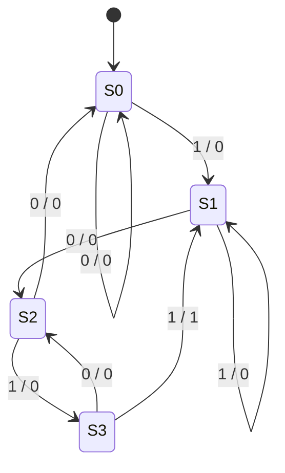

# 1011 Sequence Detector and Counter

A digital-logic project that detects the serial bit pattern **1011**, including overlapping matches, and counts detections with a **4-bit counter**. The design uses a Mealy finite-state machine implemented with D flip-flops and logic gates in Proteus.

## Project files

| File | Purpose |
| --- | --- |
| [Proteus project](proteus/sequence-detector.pdsprj) | Original circuit project, renamed for clarity |
| [Design report](docs/sequence-detector-report.docx) | State tables, Boolean equations, documented test cases and observations |

The circuit and report are preserved from the original submission. This repository packages the existing work; it does not include a new circuit implementation.

## How it works

The FSM remembers the longest suffix of the incoming stream that also matches the beginning of `1011`.

| State | Encoding Q1 Q0 | Meaning | Input 0 | Input 1 |
| --- | --- | --- | --- | --- |
| S0 | 00 | No prefix matched | S0 | S1 |
| S1 | 01 | `1` matched | S2 | S1 |
| S2 | 10 | `10` matched | S0 | S3 |
| S3 | 11 | `101` matched | S2 | S1, assert Match |

After detecting `1011`, the FSM returns to **S1**, preserving the final `1` as the start of another match. For example, `1011011` contains two overlapping detections.



Transition labels are **input / Match**. With input `X`, the report gives:

```text
D0    = X
D1    = (Q0 AND NOT X) OR (NOT Q0 AND Q1 AND X)
Match = Q1 AND Q0 AND X
```

Each detection increments the counter. A four-bit result represents counts modulo 16.

## Documented test cases

The original report records the following expected and observed counter values. These are historical observations from the report, not fresh simulation results from preparing this repository.

| Serial input | Expected detections | Reported counter value |
| --- | ---: | --- |
| `10110110010110` | 3 | `0011` |
| `1011` | 1 | `0001` |
| `1011011` | 2 | `0010` |
| `1111111` | 0 | `0000` |

## Open and simulate

1. Open `proteus/sequence-detector.pdsprj` in Proteus.
2. Inspect the circuit's clock, serial input, state flip-flops, Match signal and counter connections.
3. Initialize the state to S0 and clear the counter before each test.
4. Apply the test bits in order, keeping each bit stable around the circuit's sampling edge, and observe the detection count.

The required Proteus version has not been established, and the circuit has not been rerun as part of this repository preparation. A compatible Proteus installation and its component models are required. The repository does not distribute Proteus software or vendor libraries.

## Background

Originally developed for the Spider Electronics sequence-detection exercise. The original report describes the application as an emergency hatch authorization system. The repository is named after the circuit's function.
